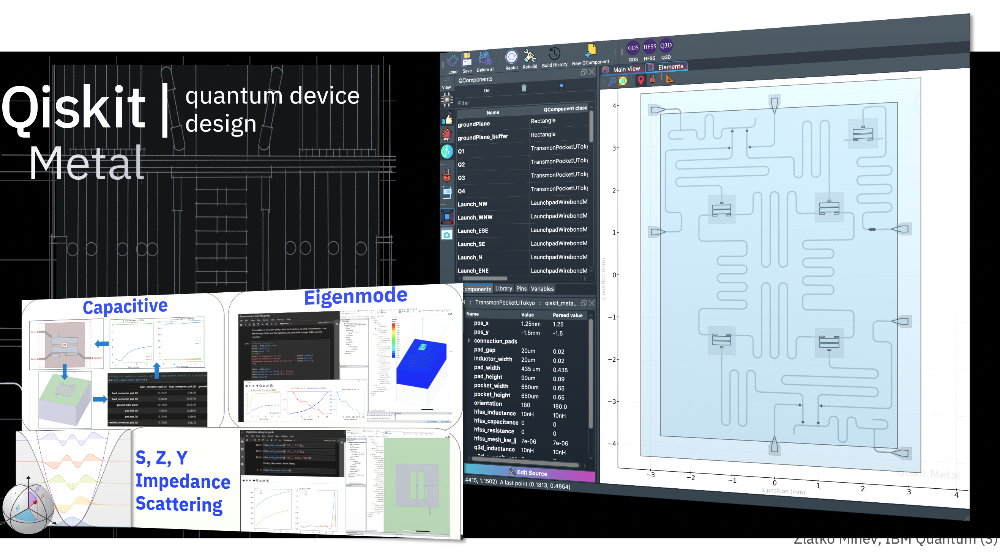

##############################################################
Quantum Metal (formerly Qiskit Metal)
##############################################################

Quantum Device Design & Analysis (Q-EDA)
^^^^^^^^^^^^^^^^^^^^^^^^^^^^^^^^^^^^^^^^

**Quantum Metal | Open source · Community-maintained quantum EDA**

Design and analyze superconducting quantum chips with a Python API + optional GUI
that plugs into your favourite EDA tools.
No Qt required — works headlessly in any Jupyter notebook or plain Python script.

.. grid:: 1 2 2 4
   :gutter: 2

   .. grid-item-card:: 🚀 Quick start
      :class-header: sd-bg-primary sd-text-light

      .. button-ref:: quickstart
         :ref-type: doc
         :color: primary
         :outline:
         :expand:

         Install and place a qubit

   .. grid-item-card:: 🔬 Research showcase
      :class-header: sd-bg-secondary sd-text-light

      .. button-ref:: research
         :ref-type: doc
         :color: secondary
         :outline:
         :expand:

         Published devices and results, reproduced

   .. grid-item-card:: 📚 Learn
      :class-header: sd-bg-primary sd-text-light

      .. button-ref:: tut/index
         :ref-type: doc
         :color: primary
         :outline:
         :expand:

         The tutorial course, in order

   .. grid-item-card:: 🧩 Examples
      :class-header: sd-bg-secondary sd-text-light

      .. button-ref:: circuit-examples/index
         :ref-type: doc
         :color: secondary
         :outline:
         :expand:

         Components and reference designs

.. rubric:: Research showcase: published devices and results, reproduced

Six notebooks (4.41-4.46) follow the package-mode couplings of a 10 × 10
transmon array (R. Molavi *et al.*, `arXiv:2609.22442
<https://arxiv.org/abs/2609.22442>`_), from an analytic estimate to a
full-wave model. Further notebooks build the 17-qubit surface-code chip of the
Wallraff group (ETH Zurich) with a meshed two-qubit cell, the 5-qubit Xmon
processor of Barends *et al.*, and three published iSWAP gates.
Notebook list, sources and requirements: :doc:`research`.

.. nblinkgallery::

    tut/4-Analysis/4.41-The-package-mode-on-paper
    tut/4-Analysis/4.42-Four-ways-to-measure-a-coupling
    tut/4-Analysis/4.43-Mesh-and-solve-the-10x10-processor
    tut/4-Analysis/4.44-Every-coupling-from-one-eigenmode
    tut/4-Analysis/4.45-Four-methods-one-full-wave-model
    tut/4-Analysis/4.46-Beyond-the-dipole-multipoles-and-magnetic-coupling
    circuit-examples/F.Small-quantum-chips/53-Wallraff_17Qubit_SurfaceCode
    circuit-examples/F.Small-quantum-chips/54-Wallraff_TwoQubit_Cell_Mesh
    circuit-examples/F.Small-quantum-chips/52-Barends_5Qubit_Xmon_Processor
    circuit-examples/F.Small-quantum-chips/Full-Physical-Design-of-iSWAP-Gates

.. rubric:: What is Quantum Metal?

Designing quantum devices is the bedrock of the quantum ecosystem, but it is a
difficult, multi-step process that connects traditionally disparate worlds.
Quantum Metal automates and streamlines this process — from layout to Hamiltonian —
in a simple, open, community-driven framework.

.. grid:: 2 2 2 4
   :gutter: 1

   .. grid-item-card:: Quantum Device Design
      :class-header: sd-bg-primary sd-text-light
      :link: qdesign
      :link-type: ref

      :ref:`qdesign`

   .. grid-item-card:: Quantum Device Components
      :class-header: sd-bg-secondary sd-text-light
      :link: qcomponents-gallery
      :link-type: doc

      Visual catalog: every transmon, coupler, route, resonator,
      termination, and lumped element shipped with Quantum Metal.

   .. grid-item-card:: Quantum Renderer
      :class-header: sd-bg-primary sd-text-light
      :link: qrenderer
      :link-type: ref

      :ref:`qrenderer`

   .. grid-item-card:: Quantum Analysis
      :class-header: sd-bg-secondary sd-text-light
      :link: qanalysis
      :link-type: ref

      :ref:`qanalysis`

.. rubric:: Community

.. grid:: 1 2 2 4
   :gutter: 1

   .. grid-item-card:: Community Discord
      :class-header: sd-bg-secondary sd-text-light

      Fastest way to reach maintainers and the broader community.

      .. button-link:: https://discord.gg/FPNybyfpxd
         :color: primary
         :outline:
         :expand:

         Join Discord

   .. grid-item-card:: Qiskit Slack #metal
      :class-header: sd-bg-primary sd-text-light

      Former main community workspace, being replaced by Discord.

      .. button-link:: https://qiskit.slack.com/archives/C01R8KP5WP7
         :color: primary
         :outline:
         :expand:

         Join #metal on Slack

   .. grid-item-card:: Quantum Device Workshop (QDW)
      :class-header: sd-bg-secondary sd-text-light

      Annual workshop hosted at UCLA/USC.

      .. button-link:: https://qdw-ucla.squarespace.com/
         :color: primary
         :outline:
         :expand:

         QDW site

      .. button-link:: https://qdw-ucla.squarespace.com/qdw2026
         :color: secondary
         :outline:
         :expand:

         Sign for 2026

   .. grid-item-card:: Quantum Device Consortium (QDC)
      :class-header: sd-bg-primary sd-text-light

      Community organization stewarding Quantum Metal.

      .. button-link:: https://qdc-qcsa.vercel.app
         :color: primary
         :outline:
         :expand:

         QDC website

      .. button-link:: https://discord.gg/FPNybyfpxd
         :color: secondary
         :outline:
         :expand:

         QDC Discord

.. note::
    **Rebrand in progress: Qiskit Metal → Quantum Metal.**
    The PyPI package is ``quantum-metal`` (v0.5+).
    A future release will rename the import path from ``qiskit_metal``
    to ``quantum_metal``; no version has been set for that yet.
    See :doc:`installation` and :doc:`migration-to-v0.7.0`.

.. toctree::
    :maxdepth: 2
    :caption: Get Started
    :hidden:

    Quick Start<quickstart>
    Installing Quantum Metal<installation>
    Choose Your Path<choose-your-path>

.. toctree::
    :maxdepth: 2
    :caption: Showcase & Learn
    :hidden:

    Research Showcase<research>
    Learn<tut/index>
    Examples<circuit-examples/index>

.. toctree::
    :maxdepth: 1
    :caption: How It Works
    :hidden:

    Quantum Metal Workflow<workflow>
    Quantization Methods<quantization>
    Simulation Pathways<simulation-pathways>
    GUI Navigation & Shortcuts<gui-shortcuts>

.. toctree::
    :maxdepth: 2
    :caption: API Reference
    :hidden:

    Overview<overview>
    QDesigns<apidocs/designs>
    QComponents<apidocs/qlibrary>
    Analyses<apidocs/analyses>
    QRenderers<apidocs/renderers>
    Toolbox<apidocs/toolbox_metal>
    QGeometry<apidocs/qgeometries>
    GUI<apidocs/gui>

.. toctree::
    :maxdepth: 1
    :caption: Project
    :hidden:

    Roadmap<roadmap>
    Frequently Asked Questions<faq>
    Migrating to v0.7.0<migration-to-v0.7.0>
    Archived Notebooks<archive>

.. toctree::
    :maxdepth: 2
    :caption: Community & Contributing
    :hidden:

    Built on / with Quantum Metal<ecosystem>
    Videos & Education<videoseducation>
    Contributor Guide<contributor-guide>
    Architecture<architecture>
    Using Quantum Metal without Qt<headless-usage>
    Code of Conduct<https://github.com/Qiskit/qiskit/blob/master/CODE_OF_CONDUCT.md>

.. Per-class autodoc stubs in ``apidocs/`` are reached via the
   autosummary ``:toctree: .`` directives in each module's
   ``__init__.py`` (e.g. ``qiskit_metal._gui/__init__.py`` lists
   ``MetalGUI`` under autosummary, which registers
   ``apidocs/qiskit_metal._gui.MetalGUI`` in a toctree). No hidden
   glob is needed.
