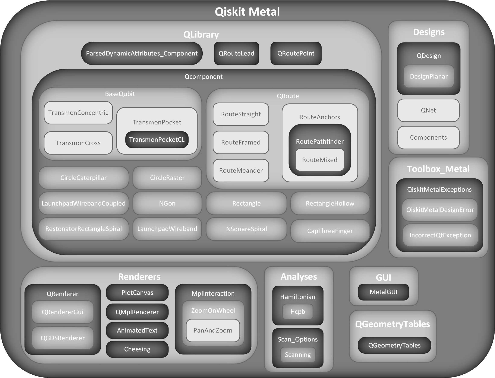

.. _overview:

*********************
Qiskit Metal Overview
*********************

**Designs**

.. list-table:: Designs details
   :widths: 10 90
   :header-rows: 1

   * - Class
     - Description
   * - :doc:`Components <apidocs/qiskit_metal.designs.Components>`
     - This is a user interface for the design._components dict. The keys are unique integers, however, this interface allows user to treat the keys as strings.  Set up variables and logger which are used to emulate a dict which is referencing design._components.
   * - :doc:`DesignPlanar <apidocs/qiskit_metal.designs.DesignPlanar>`
     - Metal class for a planar (2D) design, consisting of a single plane chip. Typically assumed to have some CPW geometries.
   * - :doc:`QDesign <apidocs/qiskit_metal.designs.QDesign>`
     - QDesign is the base class for Qiskit Metal Designs. A design is the most top-level object in all of Qiskit Metal.  Create a new Metal QDesign.
   * - :doc:`QNet <apidocs/qiskit_metal.designs.QNet>`
     - Use DataFrame to hold Net Information about the connected pins of a design. There is one uniqe net_id for each connected pin.  Hold the net information of all the USED pins within a design.

**QLibrary**

.. list-table:: Components details
   :widths: 10 90
   :header-rows: 1

   * - Class
     - Description
   * - :doc:`BaseQubit <apidocs/qiskit_metal.qlibrary.BaseQubit>`
     - Qubit base class. Use to subscript, not to generate directly.  Has connection lines that can be added.
   * - :doc:`ParsedDynamicAttributes_Component <apidocs/qiskit_metal.qlibrary.ParsedDynamicAttributes_Component>`
     - Provides a parsing view of the component options
   * - :doc:`QComponent <apidocs/qiskit_metal.qlibrary.QComponent>`
     - QComponent is the base class for all Metal components and is the central construct from which all components in Metal are derived.
   * - :doc:`QRouteLead <apidocs/qiskit_metal.qlibrary.QRouteLead>`
     - A simple class to define a an array of points with some properties, defines 2D positions and some of the 2D directions (XY plane). All values stored as np.ndarray of parsed floats.  QRouteLead is a simple sequence of points.  Used to accurately control one of the QRoute termination points.
   * - :doc:`QRoutePoint <apidocs/qiskit_metal.qlibrary.QRoutePoint>`
     - A convenience wrapper class to define an point with orientation, with a 2D position and a 2D direction (XY plane). All values stored as np.ndarray of parsed floats.
   * - :doc:`QRoute <apidocs/qiskit_metal.qlibrary.QRoute>`
     - Super-class implementing routing methods that are valid irrespective of the number of pins (>=1). The route is stored in a n array of planar points (x,y coordinates) and one direction, which is that of the last point in the array Values are stored as np.ndarray of parsed floats or np.array float pair.
   * - :doc:`Component gallery <qcomponents-gallery>`
     - Every other component class shipped with Quantum Metal (qubits, couplers, routes, resonators, terminations, lumped elements), with a thumbnail and links to its API page and example notebook.

**QGeometryTables**

.. list-table:: QGeometryTables details
   :widths: 10 90
   :header-rows: 1

   * - Class
     - Description
   * - :doc:`QGeometryTables <apidocs/qiskit_metal.qgeometries.QGeometryTables>`
     - Class to create, store, and handle element tables.

**Renderers**

.. list-table:: Renderers details
   :widths: 10 90
   :header-rows: 1

   * - Class
     - Description
   * - :doc:`AnimatedText <apidocs/qiskit_metal.renderers.AnimatedText>`
     - Class that animates text.
   * - :doc:`Cheesing <apidocs/qiskit_metal.renderers.Cheesing>`
     - Create a cheese cell based on input of no-cheese locations.
   * - :doc:`MplInteraction <apidocs/qiskit_metal.renderers.MplInteraction>`
     - Base class for class providing interaction to a matplotlib Figure.
   * - :doc:`PanAndZoom <apidocs/qiskit_metal.renderers.PanAndZoom>`
     - Class providing pan & zoom interaction to a matplotlib Figure. Left button for pan, right button for zoom area and zoom on wheel. Support subplots, twin Axes and log scales.
   * - :doc:`PlotCanvas <apidocs/qiskit_metal.renderers.PlotCanvas>`
     - Main Plot canvas widget.
   * - :doc:`QGDSRenderer <apidocs/qiskit_metal.renderers.QGDSRenderer>`
     - Extends QRenderer to export GDS formatted files. The methods which a user will need for GDS export should be found within this class.  All chips within design should be exported to one gds file. For the “subtraction box”: 1. If user wants to export the entire design, AND if the base class of QDesign._chips[chip_name][‘size’] has dict following below example: {‘center_x’: 0.0, ‘center_y’: 0.0, ‘size_x’: 9, ‘size_y’: 6} then this box will be used for every layer within a chip.  2. If user wants to export entire design, BUT there is not information in QDesign._chips[chip_name][‘size’], then the renderer will calcuate the size of all of the components and use that size for the “subtraction box” for every layer within a chip.  3. If user wants to export a list of explicit components, the bounding box will be calculated by size of QComponents in the QGeometry table. Then be scaled by bounding_box_scale_x and bounding_box_scale_y.  4. Note: When using the Junction table, the cell for Junction should be “x-axis” aligned and then GDS rotates based on LineString given in Juction table.
   * - :doc:`QMplRenderer <apidocs/qiskit_metal.renderers.QMplRenderer>`
     - Matplotlib handle all rendering of an axis.  The axis is given in the function render.
   * - :doc:`QRenderer <apidocs/qiskit_metal.renderers.QRenderer>`
     - Abstract base class for all Renderers of Metal designs and their components and qgeometry.
   * - :doc:`QRendererGui <apidocs/qiskit_metal.renderers.QRendererGui>`
     - Abstract base class for the GUI rendering. Extends QRenderer. An interface class.
   * - :doc:`ZoomOnWheel <apidocs/qiskit_metal.renderers.ZoomOnWheel>`
     - Class providing zoom on wheel interaction to a matplotlib Figure.  This class extends the MplInteraction class.  Supports subplots, twin Axes and log scales.

**Analyses**

.. list-table:: Analyses grouping
   :widths: 10 90
   :header-rows: 1

   * - Group
     - Description
   * - :doc:`Hamiltonian <apidocs/qiskit_metal.analyses.Hcpb>`
     - Module containing all Qiskit Metal hamiltonian-only analyses.
   * - :doc:`Sweep_Options <apidocs/qiskit_metal.analyses.Sweeper>`
     - Module containing all Qiskit Metal sweeping options for analyses.

.. list-table:: Analyses details
   :widths: 10 90
   :header-rows: 1

   * - Class
     - Description
   * - :doc:`Hcpb <apidocs/qiskit_metal.analyses.Hcpb>`
     - Used to model analytically the CPB Hamiltonian quickly and efficiently. Solves tridiagonal eigenvalue problem for arbitrary Ej, Ec, ng values.
   * - :doc:`Sweeping <apidocs/qiskit_metal.analyses.Sweeper>`
     - Need access to renderers which are registered in QDesign.

**GUI**

.. list-table:: GUI details
   :widths: 10 90
   :header-rows: 1

   * - Class
     - Description
   * - :doc:`MetalGUI <apidocs/qiskit_metal._gui.MetalGUI>`
     - Qiskit Metal Main GUI.  This class extends the QMainWindowBaseHandler class.  The GUI can be controled by the user using the mouse and keyboard or API for full control.

**Toolbox_Metal**

.. list-table:: Toolbox_Metal details
   :widths: 10 90
   :header-rows: 1

   * - Class
     - Description
   * - :doc:`QiskitMetalDesignError <apidocs/qiskit_metal.toolbox_metal.QiskitMetalDesignError>`
     - Custom Exception to indicate User action is needed to correct Design Inputs.
   * - :doc:`QiskitMetalExceptions <apidocs/qiskit_metal.toolbox_metal.QiskitMetalExceptions>`
     - Custom Exception super-class. Every Exception raised by qiskit-metal should inherit this. Adds the qiskit-metal prefix.
