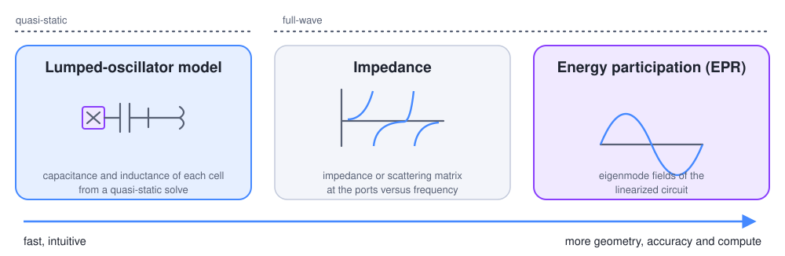
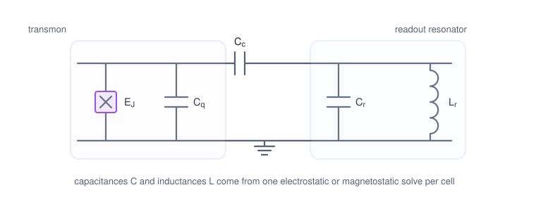
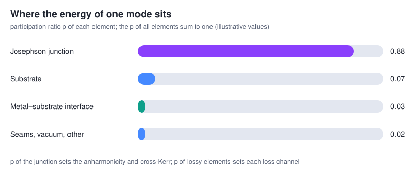

.. _quantization:

*********************
Quantization methods
*********************

An electromagnetic solver returns fields, capacitances and impedances. To get a
Hamiltonian (mode frequencies, anharmonicities, dispersive shifts, couplings) the
result has to be *quantized*. Quantum Metal supports three routes, from a quick
quasi-static estimate to a full-wave solve. They answer the same question at
different cost, so it is common to start with the cheapest and check against the
next.

.. list-table::
   :header-rows: 1
   :widths: 17 24 24 35

   * - Method
     - You solve
     - You get
     - Use it when
   * - **Lumped-oscillator model (LOM)**
     - capacitance (and inductance) of each cell, quasi-static
     - frequencies, anharmonicities, couplings of a circuit assembled from cells
     - exploring geometry; routing and first-order couplings; no eigenmode solve needed
   * - **Energy participation (EPR)**
     - eigenmodes of the linearized circuit, full-wave
     - Hamiltonian with field-aware couplings, and a loss budget per volume or interface
     - layout details matter: packaging, higher modes, seams, substrate loss
   * - **Impedance**
     - impedance or scattering matrix versus frequency at the ports
     - mode frequencies and couplings read from poles and residues
     - many ports (bus networks, Purcell filters, packages), or as an independent check of EPR

Where to run each one:

.. list-table::
   :header-rows: 1
   :widths: 20 40 40

   * - Method
     - In Quantum Metal
     - Tutorials
   * - LOM
     - ``LOManalysis`` and the composite-system classes below; capacitance from Q3D or ElmerFEM
     - :doc:`4.01 <tut/4-Analysis/4.01-Capacitance-and-LOM>`,
       :doc:`4.04 <tut/4-Analysis/4.04-New-LOM-and-Fluxonium-Example>`,
       :doc:`4.05 <tut/4-Analysis/4.05-New-LOM-and-Two-Coupled-Transmon-Example-with-sequence>`
   * - EPR
     - ``EPRanalysis`` with pyEPR and HFSS; the scikit-fem solver implements the same couplings without Ansys
     - :doc:`4.02 <tut/4-Analysis/4.02-Eigenmode-and-EPR>`,
       :doc:`4.11 <tut/4-Analysis/4.11-Analyze-and-tune-a-transmon>` to
       :doc:`4.13 <tut/4-Analysis/4.13-Analyze-transmon-and-resonator>`,
       :doc:`4.42 <tut/4-Analysis/4.42-Four-ways-to-measure-a-coupling>`
   * - Impedance
     - ``ScatteringImpedanceSim`` for the matrices; 4.42 also derives couplings from the impedance matrix
     - :doc:`4.03 <tut/4-Analysis/4.03-Impedance>`,
       :doc:`4.14 <tut/4-Analysis/4.14-Analyze-a-double-hanger-resonator>`,
       :doc:`4.42 <tut/4-Analysis/4.42-Four-ways-to-measure-a-coupling>`

Which solver each method needs is compared on :doc:`simulation-pathways`.

Lumped-oscillator model
=======================

Treat each part of the chip as a compact circuit element. Cut the device into a
few cells, extract each cell's capacitance and inductance with a fast
quasi-static solve, assemble the network, and quantize it. The reduction keeps
the pairwise couplings, so renormalization and loading are tracked and the
result is a small Hamiltonian you can iterate on in minutes.

Choose it for early design and sweeps, when speed and an intuitive circuit
picture matter more than field detail. Because each solve is cheap, many
geometry and stack variants can be compared before a heavier solver is needed.

* Z. K. Minev, T. G. McConkey, M. Takita, A. D. Corcoles, J. M. Gambetta,
  `Circuit quantum electrodynamics (cQED) with modular quasi-lumped models
  <https://arxiv.org/abs/2103.10344>`_ (2021).

Energy-participation ratio (EPR)
================================

The energy-participation ratio of an element in a mode is the fraction of the
mode's energy stored in that element, a number between zero and one. The
participations of the nonlinear (Josephson) elements fix the Hamiltonian, and
those of the lossy elements fix the loss, whatever the circuit topology. They
come from one eigenmode simulation of the linearized circuit, so the method
quantizes multi-junction and 3D circuits without a hand-built circuit model.

Choose it when layout details matter: packaging, higher modes, junction
placement, seams and substrate loss. Draw the design, set materials and
boundaries, place the junction ports, and run one eigenmode solve; pyEPR reads
the fields and returns frequencies, dispersive shifts, anharmonicities and loss
budgets. It is best tested for weakly anharmonic circuits such as transmons
coupled to resonators.

* Z. K. Minev, Z. Leghtas, S. O. Mundhada, L. Christakis, I. M. Pop,
  M. H. Devoret, `Energy-participation quantization of Josephson circuits
  <https://arxiv.org/abs/2010.00620>`_, npj Quantum Information 7, 131 (2021).
* Z. K. Minev et al., `pyEPR <https://github.com/zlatko-minev/pyEPR>`_
  (`documentation <https://pyepr-docs.readthedocs.io>`_).
* Z. K. Minev, Ph.D. dissertation, Yale University (2018), chapter 4,
  `arXiv:1902.10355 <https://arxiv.org/abs/1902.10355>`_.

Impedance
=========

The impedance route starts from the frequency-dependent impedance (or
scattering) matrix at the ports, the same quantity a network analyzer measures.
The modes appear as poles, and their frequencies, couplings and nonlinear
participation follow from the pole and residue structure. It shares the
fields-first philosophy of EPR, and is the natural handle for layouts with many
ports or modes: bus networks, Purcell filters and chip-package assemblies. It is
also an independent check of EPR couplings.

Define ports at the junctions or pins, run a driven or eigenmode solve to get
the matrix versus frequency, and sample around the modes of interest.

* S. E. Nigg, H. Paik, B. Vlastakis, G. Kirchmair, S. Shankar, L. Frunzio,
  M. H. Devoret, R. J. Schoelkopf, S. M. Girvin, `Black-box superconducting
  circuit quantization <https://arxiv.org/abs/1204.0587>`_,
  Phys. Rev. Lett. 108, 240502 (2012).

Next
====

Run the methods side by side in the 4.4x tutorials (:doc:`tut/simulate-and-analyze`), or see
:doc:`simulation-pathways` for the solvers behind them. The class reference follows.

.. _lom-composite-api:

Reference: ``Cell`` / ``Subsystem`` / ``CompositeSystem``
=========================================================

The lumped-oscillator model is assembled from three classes in
:mod:`qiskit_metal.analyses.quantization.lom_core_analysis`. A **Cell** holds
an extracted capacitance matrix plus any inductors and junctions; a
**Subsystem** maps a set of circuit nodes to a quantum model (transmon,
fluxonium, transmission-line or lumped resonator, ...); and a
**CompositeSystem** reduces and quantizes the combined network. These are the
classes used in tutorials ``4.04`` and ``4.05``.

The accepted ``q_opts`` for every built-in subsystem ``sys_type``
(``TRANSMON``, ``FLUXONIUM``, ``TL_RESONATOR``, ``LUMPED_RESONATOR``) — which
values you supply and which are computed from the extracted L and C matrices —
are listed on :class:`Subsystem` below. Call
:meth:`QuantumSystemRegistry.registry` to enumerate every registered type,
including any custom builder you add.

.. currentmodule:: qiskit_metal.analyses.quantization.lom_core_analysis

.. autoclass:: Cell
   :members:

.. autoclass:: Subsystem
   :members:

.. autoclass:: CompositeSystem
   :members:

.. autoclass:: QuantumSystemRegistry
   :members:

