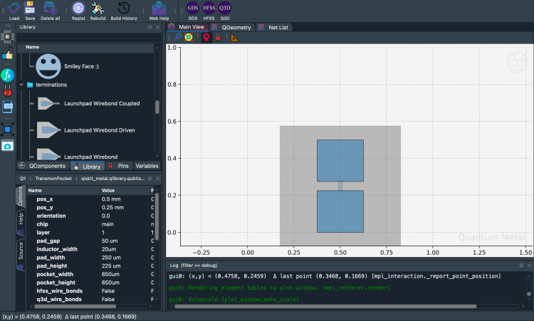

.. _quickstart:

***********
Quick start
***********

.. button-link:: https://colab.research.google.com/github/qiskit-community/qiskit-metal/blob/main/docs/tut/1-Overview/1.1-Quick-start.ipynb
    :color: primary
    :shadow:
    :expand:

    Open the quick start in Colab (no install)

Three ways to work
==================

The same design object works in all three. Pick one, or switch later.

.. grid:: 1 1 3 3
    :gutter: 2

    .. grid-item-card:: Headless
        :class-header: sd-bg-primary sd-text-light

        Python scripts, notebooks, Colab, servers. No Qt, no display.
        ``qm.view(design)`` draws the layout with matplotlib; every
        component, renderer and analysis is available.

    .. grid-item-card:: Desktop GUI
        :class-header: sd-bg-secondary sd-text-light

        ``MetalGUI``: dockable window with component library, option
        editor and layer view. Needs ``pip install "quantum-metal[gui]"``
        and a display. See :doc:`gui-shortcuts`.

    .. grid-item-card:: Both
        :class-header: sd-bg-primary sd-text-light

        Build and script in a notebook or script, open the same design in
        ``MetalGUI`` to inspect and adjust it by hand. ``qm.gui(design)``
        picks the GUI when it can and the inline viewer otherwise.

Details of the Qt-free path: :doc:`headless-usage`.

.. admonition:: Want a result fast?
    :class: tip

    - :doc:`1.3 Build a 4-qubit chip <tut/1-Overview/1.3-Build-a-4-qubit-chip>`:
      four transmons joined by meander CPWs, with shared variables.
    - :doc:`2.21 Design a 4 qubit full chip <tut/2-From-components-to-chip/2.21-Design-a-4-qubit-full-chip>`:
      a complete chip, exported to GDS.

Install
=======

Install the lite package (no Qt, no Ansys):

.. code-block:: bash

    pip install quantum-metal

Extras, conda and source installs are described in :doc:`installation`.

First design
============

Place a transmon and change one option. The code below is taken from the
cells of the notebook :doc:`1.1 Quick start <tut/1-Overview/1.1-Quick-start>`.

.. code-block:: python

    import qiskit_metal as qm
    from qiskit_metal import designs

    design = designs.DesignPlanar()
    gui = qm.gui(design)  # Qt locally, inline matplotlib in Colab/Binder

    from qiskit_metal.qlibrary.qubits.transmon_pocket import TransmonPocket

    q1 = TransmonPocket(design, "Q1")
    gui.rebuild()  # rebuild the design and plot

    q1.options.pos_x = "0.5 mm"
    q1.options.pos_y = "0.25 mm"
    q1.options.pad_height = "225 um"
    q1.options.pad_width = "250 um"
    q1.options.pad_gap = "50 um"
    gui.rebuild()

    gui.autoscale()
    gui.screenshot()

``qm.gui(design)`` returns the desktop ``MetalGUI`` when PySide6 and a display
are available, and an inline matplotlib viewer otherwise. Both expose the same
``gui.*`` calls. ``qm.view(design)`` draws a design into any matplotlib axes
without a GUI object.

    Output of the last cell, as stored in notebook 1.1.

.. button-ref:: tut/index
    :ref-type: doc
    :color: secondary
    :outline:
    :expand:

    Continue: the learning path
