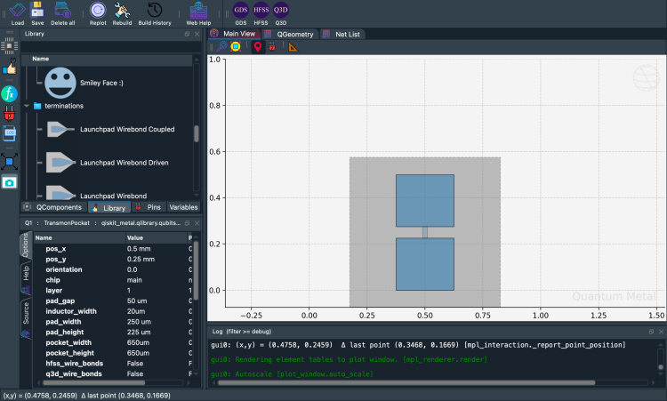

.. _quickstart:

***********
Quick start
***********

Install the lite package (no Qt, no Ansys):

.. code-block:: bash

    pip install quantum-metal

Extras, conda and source installs are described in :doc:`installation`.

Place a transmon and change one option. The code below is taken from the
cells of the notebook :doc:`1.1 Quick start <tut/1-Overview/1.1-Quick-start>`.

.. code-block:: python

    import qiskit_metal as qm
    from qiskit_metal import designs

    design = designs.DesignPlanar()
    gui = qm.gui(design)  # Qt locally, inline matplotlib in Colab/Binder

    from qiskit_metal.qlibrary.qubits.transmon_pocket import TransmonPocket

    q1 = TransmonPocket(design, "Q1")
    gui.rebuild()  # rebuild the design and plot

    q1.options.pos_x = "0.5 mm"
    q1.options.pos_y = "0.25 mm"
    q1.options.pad_height = "225 um"
    q1.options.pad_width = "250 um"
    q1.options.pad_gap = "50 um"
    gui.rebuild()

    gui.autoscale()
    gui.screenshot()

``qm.gui(design)`` returns the desktop ``MetalGUI`` when PySide6 and a display
are available, and an inline matplotlib viewer otherwise. Both expose the same
``gui.*`` calls. ``qm.view(design)`` draws a design into any matplotlib axes
without a GUI object.

    Output of the last cell, as stored in notebook 1.1.

.. grid:: 1 2 2 2
    :gutter: 2

    .. grid-item-card:: Run it in a notebook
        :class-header: sd-bg-primary sd-text-light

        .. button-link:: https://colab.research.google.com/github/qiskit-community/qiskit-metal/blob/main/docs/tut/1-Overview/1.1-Quick-start.ipynb
            :color: primary
            :outline:
            :expand:

            Open 1.1 in Colab

    .. grid-item-card:: Continue
        :class-header: sd-bg-secondary sd-text-light

        .. button-ref:: tut/index
            :ref-type: doc
            :color: secondary
            :outline:
            :expand:

            Continue: the learning path
