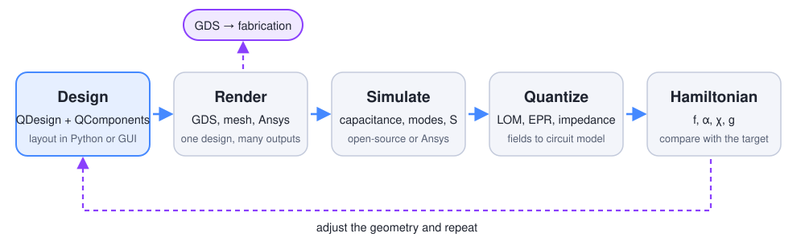

.. _workflow:

**********************
Quantum Metal workflow
**********************

A superconducting chip is designed in a loop: draw the geometry, solve the
electromagnetics, quantize the result into a circuit Hamiltonian, compare it
with the target, and change the geometry. Quantum Metal keeps the whole loop in
one Python environment, so a change of a pad width reaches the Hamiltonian in
minutes, and the same design object leaves for the foundry as a GDS file.

Each step has a tutorial that does it end to end. This page says what the step
produces and where to start.

.. grid:: 1 1 2 2
   :gutter: 3
   :class-container: qm-steps

   .. grid-item-card:: 1. Design
      :img-top: _static/workflow/design-gui.png
      :img-alt: The Quantum Metal desktop GUI with a transmon on a chip

      A ``QDesign`` holds the chip. ``QComponent`` objects (transmons,
      resonators, launchpads, couplers) are placed with options, and routes
      connect pins. Work in a notebook or in the desktop GUI; the design is the
      same either way.

      :doc:`Quick start <quickstart>` ·
      :doc:`1.3 Build a 4-qubit chip <tut/1-Overview/1.3-Build-a-4-qubit-chip>` ·
      :doc:`2.21 A full chip <tut/2-From-components-to-chip/2.21-Design-a-4-qubit-full-chip>`

   .. grid-item-card:: 2. Render
      :img-top: _static/workflow/gds-layers.png
      :img-alt: GDS layers of a Josephson junction cell

      A renderer turns the design into another representation: a GDS file for
      fabrication, a gmsh mesh for a field solver, or a project in Ansys. Design
      rules can be checked before you export.

      :doc:`Part 3: Render and export <tut/render-and-export>` ·
      :doc:`2.24 Design-rule checking <tut/2-From-components-to-chip/2.24-Design-rule-checking>`

   .. grid-item-card:: 3. Simulate
      :img-top: _static/workflow/eigenmode-field.png
      :img-alt: Electric field of a package mode on a 10 by 10 transmon array

      A solver returns capacitance matrices, eigenmodes with their fields, or
      scattering and impedance matrices. Use ElmerFEM or the gmsh and
      scikit-fem solver with no license, or Ansys HFSS and Q3D.

      :doc:`Part 4: Simulate and analyze <tut/simulate-and-analyze>` ·
      :doc:`Simulation pathways <simulation-pathways>`

   .. grid-item-card:: 4. Quantize and compare
      :img-top: _static/workflow/levels.png
      :img-alt: Wavefunctions and energy levels of an anharmonic oscillator

      The fields become a circuit model and then a Hamiltonian: mode
      frequencies, anharmonicities, dispersive shifts, couplings and loss
      budgets. Pick the method that matches the question.

      :doc:`Quantization methods <quantization>` ·
      :doc:`4.01 Capacitance and LOM <tut/4-Analysis/4.01-Capacitance-and-LOM>` ·
      :doc:`4.02 Eigenmode and EPR <tut/4-Analysis/4.02-Eigenmode-and-EPR>`

Which path to take
==================

.. list-table::
   :header-rows: 1
   :widths: 30 35 35

   * - You want
     - Start with
     - Needs
   * - A layout and a GDS file
     - Quick start, then Parts 1 to 3
     - ``pip install quantum-metal``
   * - Capacitances and a Hamiltonian, no Ansys
     - The open-source solver path in Part 4
     - ``[mesh]`` or ``[skfem]`` extra, ElmerFEM
   * - Eigenmodes, EPR and S-parameters
     - 4.02 and the Ansys notebooks of Part 4
     - Ansys Electronics Desktop
   * - To reproduce a published chip
     - :doc:`Reproduced devices <research>`
     - see each notebook

The full list of paths, each an ordered set of notebooks, is on
:doc:`choose-your-path`.

Where Metal sits in a larger design flow
========================================

A classical integrated circuit goes through a design flow that has been tuned
for decades. Quantum chips are larger per bit and carry more varied
superconducting circuitry, and general electronic design tools cover only part
of that flow. Quantum Metal covers the part from concept to layout and from
layout to Hamiltonian, and hands the layout to fabrication. For the original
motivation, see the `Qiskit blog post
<https://medium.com/qiskit/what-if-we-had-a-computer-aided-design-program-for-quantum-computers-4cb88bd1ddea>`_
announcing the project.

Next
====

Start with :doc:`tut/1-Overview/1.1-Quick-start`, or pick a route in :doc:`choose-your-path`.
For which solver to use, see :doc:`simulation-pathways`; for the theory behind the Hamiltonian step, see :doc:`quantization`.
